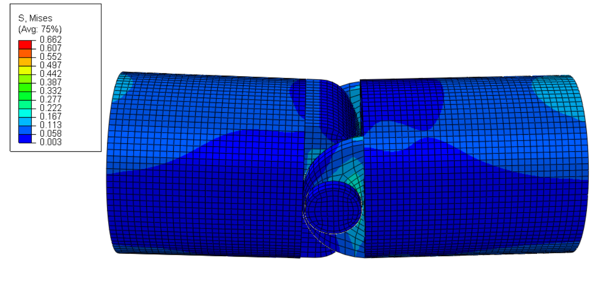
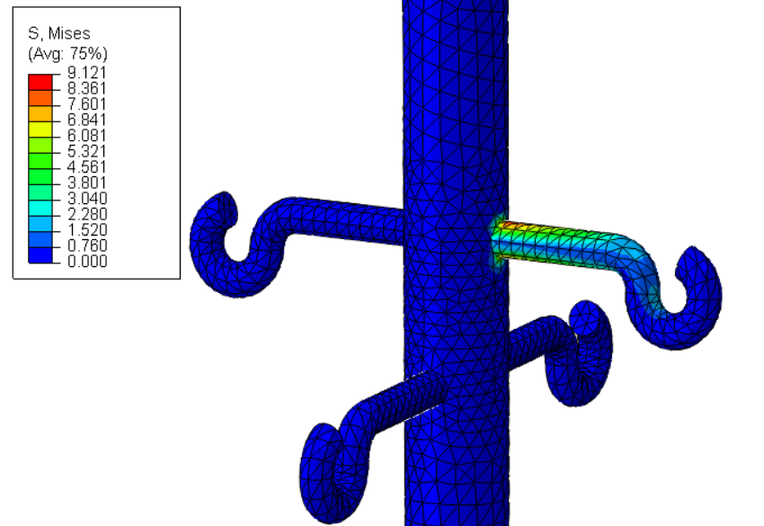

# Lorena Pop
### Finite element analysis projects in Abaqus

Three static models I built in Abaqus/CAE 6.14. Below, for each one: what I modelled, how the model is set up, what came out, and what the model does not cover. The full setup files and READMEs are in the repositories.

---

## 1. Hand rehabilitation device (bachelor's thesis)
[Repository](https://github.com/lorena-pop84/abaqus-hand-rehabilitation-device)

**What it is.** A 3D-printed PETG lever (287 × 20 × 10 mm) that turns on an axle, with a spring pushing on a small peg on the other side. I upgraded a lever device made by a former student; the lever length and the force-balance relation come from his earlier work.

**How I modelled it.** A static "snapshot" with the forces balanced, not a motion simulation. A 4 N force acts at the handle, 118 mm from the axle. Instead of modelling the spring, I replaced it with the equivalent pressure on the peg (137 mm from the axle): 4 × 118 / 137 = 3.445 N, which is 0.274 MPa. The mesh has about 39,000 hexahedral elements, built with manual partitioning. There are 13 friction contact pairs (friction 0.2), the lever is tied to the axle, and the base is fixed. The material is solid PETG (E = 2200 MPa).

**Results.** Max von Mises stress 3.3 MPa near the axle; max displacement 3.6 mm at the handle. Compared with bulk PETG strength (45-55 MPa) this gives an indicative safety factor of about 14-17. A printed part is weaker than bulk material, so I treat this only as a rough indication.

**Limits.** The axle and its hole are simplified to rectangles and tied together. The real part has gyroid infill, while the model is solid. One mesh only, no mesh convergence study, no physical measurements.

---

## 2. PIP finger-joint prosthesis (simplified hinge)
[Repository](https://github.com/lorena-pop84/abaqus-finger-joint-prosthesis)

**What it is.** A simplified hinge with four parts: a fixed implant with ears, a moving distal part, a pin and a nut, all Ti-6Al-4V. The geometry was provided to me; I built the analysis model.

**How I modelled it.** The pin is tied to the implant ears, and the distal part turns on the pin through two friction contact pairs (friction 0.15). A 10 N reference force acts on the distal part, with the rotation about the pin locked, so this is a static check at one fixed angle, not a bending simulation. About 56,000 hexahedral elements, hand-partitioned.

**Results.** Max von Mises stress 0.66 MPa around the pin and ears; max contact pressure 0.90 MPa; displacement below 0.005 mm. The 10 N is a reference value, so I did not calculate a safety factor.

**Limits.** One load case, no tendon forces, no bone, no wear or fatigue, no mesh convergence study, no physical measurements.

---

## 3. Medical IV stand
[Repository](https://github.com/lorena-pop84/abaqus-medical-iv-stand)

**What it is.** A wheeled aluminium IV stand (E = 70,000 MPa). The geometry was made in Creo by a colleague and imported into Abaqus; I rebuilt the whole analysis model (mesh, ties, supports, loads, load cases).

**How I modelled it.** Tetrahedral mesh, 9 ties between parts, the 4 wheels fixed. Each hook is loaded through a reference point with a distributing coupling, which spreads the force over the hook's end section. Two cases: 4 hooks with 5 N each (20 N total), and 1 hook with 15 N.

| | 4 hooks × 5 N | 1 hook × 15 N |
|---|---|---|
| Max von Mises stress | 3.6 MPa | 9.1 MPa |
| Max displacement | 0.019 mm | 0.80 mm |

**What I take from it.** The single hook carries 25% less load, but the stress is about 2.5 times higher and the stand bends about 42 times more. Where the load sits matters more than how big it is. The highest stress is at the root of the hook.

**Limits.** Linear elastic material, no mesh convergence study, no physical measurements.

---

## Contact
[LinkedIn](https://www.linkedin.com/in/pop-lorena) · [GitHub](https://github.com/lorena-pop84) · lorena.pop84@gmail.com
